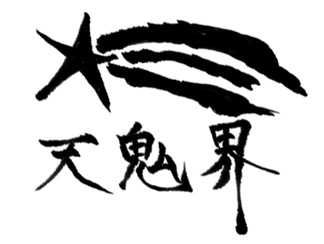

# マダラー星人

  

## 原作

- バーサス
- 原作/ONE 漫画/あずま京太郎 構成/bose
- [マガポケ](https://pocket.shonenmagazine.com/title/01990/episode/362449) で読めます
- [Amazon Kindle](https://www.amazon.co.jp/dp/B0BVBQ2ZK9)

## MUGENキャラ概要

- MUGENキャラ化した人: pkrs

## このキャラについて

- バーサスに登場するマダラー星人です。

## 技

### 通常技

### 必殺技

### 超必殺

## ドット、音源など

- ドット絵: 全て手打ちです
- 音源: TODO

## 転載など

- 好きにしてください
- 連絡先:
    - 以下のどちらかにどうぞ
    - [GitHub Issues](https://github.com/t-akira012/tenkikai)
    - [Twitter @raya77x2](https://x.com/raya77x2)
